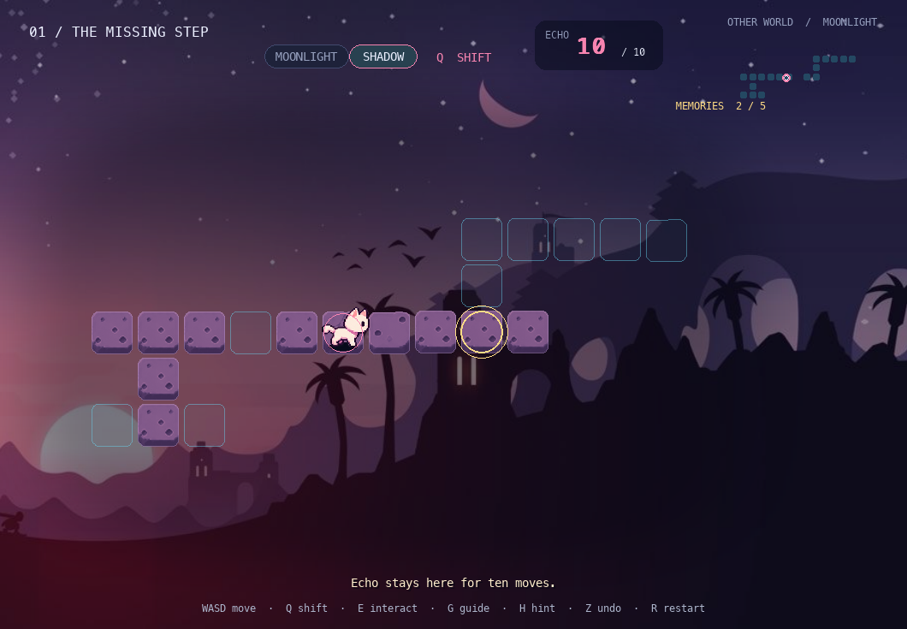
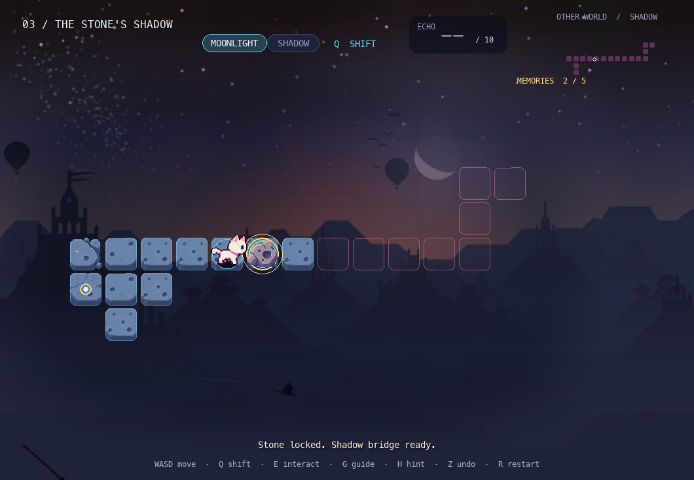
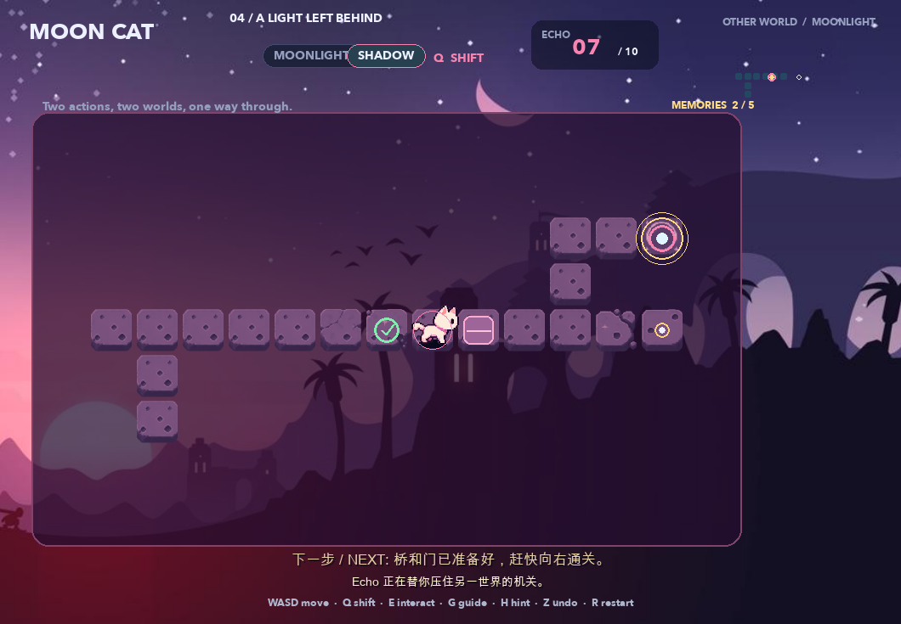

# MOON CAT — The Space Between

**SD5913 Assignment 3 — Interaction Design Prototype**

MOON CAT is a short, mechanism-driven puzzle game built with Python and
pygame-ce. The player explores the same space in two connected states:
Moonlight and Shadow. Pressing `Q` changes the active world, which changes
which paths, bridges, doors, and mechanisms can be used.

The final submission version is located in [`mooncat_meteorite_tiles/`](mooncat_meteorite_tiles/).



## Project Overview

The prototype contains five compact puzzle rooms. Each room develops the same
core idea instead of introducing unrelated controls: observe both worlds,
choose where to move, shift at the correct location, and read the resulting
change. Later rooms add a pushable stone, a pressure plate, a lantern, bridges,
doors, and a temporary Echo left behind during a world shift.

## Intended Users

The game is intended for players who enjoy exploration and light puzzle
solving. It uses a small keyboard input set, progressive guidance, undo, and
restart so that players can experiment without a harsh failure penalty.

## Core Interaction

The player moves through a grid-based map and presses `Q` to shift between the
Moonlight and Shadow worlds. The two worlds share coordinates but contain
different walkable routes and mechanisms. Solving a room requires understanding
how an action in one world changes access or state in the other.

## Input → Response → Feedback

The interaction loop is implemented directly in `mooncat_meteorite_tiles/main.py`:

| Input | System response | Player feedback |
|---|---|---|
| `WASD` / arrow key | Validates the destination and moves the player or pushes the Room 3 stone | Cat movement animation, step/push sound, floating-tile alignment; invalid movement produces a shake, sound, and contextual message |
| `Q` | Validates the corresponding coordinate, switches world, and leaves an Echo in the departed world | World crossfade, accent-colour change, altered roads, Echo sprite, sound, and updated HUD |
| `E` | Interacts with the lantern in Room 4 when the player is in the correct position and world | Lantern and bridge state change, particles, sound, and a short message |
| Stone reaches plate | Activates the cross-world bridge dependency | Plate turns active, particles appear, and a message explains that the Shadow bridge is now available |
| Echo expires | Removes the Echo after ten subsequent successful moves | `ECHO 07 / 10`-style counter decreases; at zero the Echo disappears and its pressure-plate effect ends |
| `H`, `G`, `Z`, `R` | Reveals help, opens the room guide, undoes, or restarts | Progressive text hints, guide overlay, restored state, or reset room |

This makes the result of an action visible through the map, animation, sound,
colour, HUD, and concise contextual text rather than relying on instructions
alone.

## Controls

- `W`, `A`, `S`, `D` or arrow keys — move
- `Q` — shift between Moonlight and Shadow; leave an Echo
- `E` — interact with the Room 4 lantern
- `H` — progressive hint
- `G` — open or close the room guide
- `Z` or Backspace — undo one action
- `R` — restart the current room
- `Enter` or Space — start, close the guide, or continue after a solved room
- `1`–`5` — select an unlocked room from the menu
- `Esc` — return to the menu; press again from the menu to quit

## Installation and Running

### Requirements

- macOS, Windows, or Linux with keyboard input
- [uv](https://docs.astral.sh/uv/)
- Git

Clone and run from a terminal:

```bash
git clone https://github.com/Naomii-iom/MOON-CAT-The-Space-Between.git
cd MOON-CAT-The-Space-Between
uv sync --frozen
uv run python mooncat_meteorite_tiles/main.py
```

`uv` reads `.python-version`, creates the local virtual environment, and
installs the locked `pygame-ce` dependency from `uv.lock`.

## Screenshots

### Full-screen puzzle view


### Room 3 pushable stone



### Echo remaining-move HUD



## Evidence and Documentation

- [`PROCESS.md`](PROCESS.md) — concept, iteration, real user testing, design decisions, and reflection
- [`CREDITS.md`](CREDITS.md) — authorship, tools, assets, licences, and AI disclosure
- [`mooncat_meteorite_tiles/screenshots/verification.json`](mooncat_meteorite_tiles/screenshots/verification.json) — automated regression evidence
- [`mooncat_meteorite_tiles/screenshots/browser_test_result.json`](mooncat_meteorite_tiles/screenshots/browser_test_result.json) — browser test record

## Known Limitations

- The implemented move constraint is the Echo's ten-move lifetime, not a
  separate whole-level move cap. When the counter reaches zero, the Echo and
  its mechanism effect disappear; the player is not forced into a game-over.
- The most recent submission build is verified as a desktop pygame-ce project.
  An older Pygbag web experiment exists in the repository, but there is no
  current hosted live-demo URL, so no live-demo claim is made here.
- Visual source files were supplied through the project workflow. Their right
  to be redistributed commercially has not been independently verified; this
  repository is presented as coursework.

## Credits and AI Usage

Game concept, interaction decisions, art selection, playtesting, and iteration
were directed by **Liu Yuchen**. ChatGPT supported early discussion and design
reflection. OpenAI Codex / Work assisted with programming, debugging, test
automation, integration, documentation, and GitHub preparation. The student
accepted, modified, or rejected suggestions based on playtesting and the goal
of keeping the map readable. Full details are recorded in [`CREDITS.md`](CREDITS.md)
and [`PROCESS.md`](PROCESS.md).
