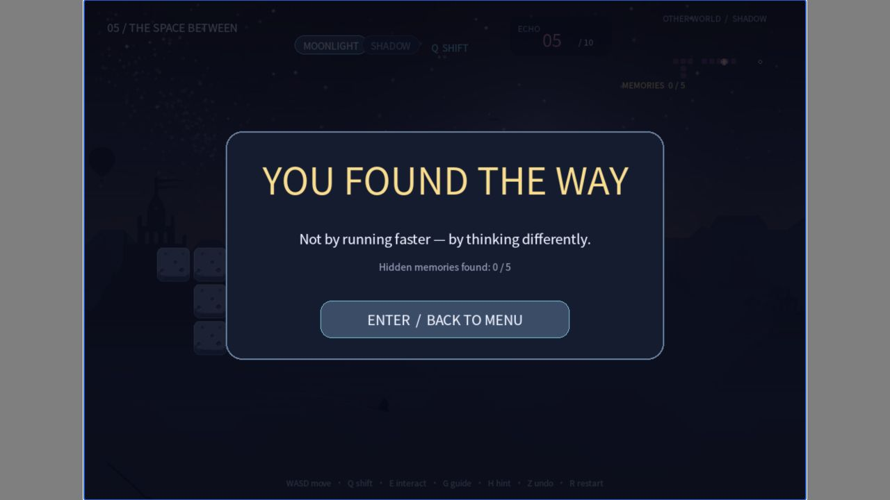

# Web Test Results

Tested on November 9, 2026.

## Actual browser tests

- **Chromium-based in-app browser:** PASS. I started the game, completed Rooms 1–5, and reached the final completion screen.
- **Safari on macOS:** PASS for loading, font rendering, keyboard start, and the Room 1 guide overlay.
- **Progress storage:** PASS. After completing all rooms, refreshing the browser restored `Unlocked: 5/5` from local storage.

## Feature checks

| Feature | Result |
|---|---|
| Room 1 world shift with `Q` | PASS |
| Room 2 Echo plate and gate | PASS |
| Room 3 stone, pressure plate, undo, and Shadow bridge | PASS |
| Room 4 lantern interaction and Echo | PASS |
| Room 5 completion | PASS |
| `G` room guide | PASS |
| `H` progressive hint | PASS |
| `Z` undo | PASS |
| `R` restart | PASS |
| Bundled font and final artwork | PASS |
| Browser local-storage progress | PASS |

Named Google Chrome and Microsoft Edge applications were not available to the automated browser harness, so I do not claim separate runs in those applications. The complete five-room run was performed in a Chromium-based browser, and Safari received a separate native-browser smoke test.

